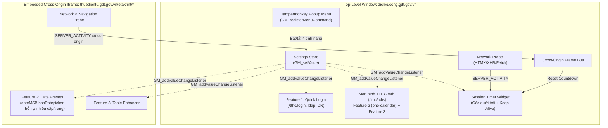

# SPEC — eTax Helper (Tampermonkey Userscript Doanh Nghiệp)

> **Trạng thái tài liệu:** Bản hoàn thiện v2.0 — Đã hoàn tất Giai đoạn 1 (F12 thực tế), Giai đoạn 2 (Mã nguồn + Unit Tests + Build `dist/`), cấu hình sẵn Giai đoạn 3 (GitHub Actions) & Giai đoạn 4 (Tài liệu đội ngũ)  
> **Phạm vi áp dụng (ĐÃ XÁC MINH — 2 tên miền):**
> - Vỏ ngoài / Cổng Dịch vụ công Thuế (TTHC mới): `https://dichvucong.gdt.gov.vn/*` *(Spring Boot + Thymeleaf + Bootstrap 5 + HTMX; màu chủ đạo `#006FBC`)*
> - Khung `<iframe>` nghiệp vụ eTax nhúng trong mục *Dịch vụ khác*: `https://thuedientu.gdt.gov.vn/*` *(SSO từ cổng dịch vụ công sang `/etaxnnt/`, dùng bảng HTML truyền thống + jQuery UI Datepicker)*  
> **Phạm vi đăng nhập ưu tiên:** Màn hình đăng nhập **Doanh nghiệp** (`https://dichvucong.gdt.gov.vn/tthc/login`, `ldap = "DN"`, tài khoản dạng `MST-QL`)  
> **Kênh phân phối đã chốt:** **Phương án A — GitHub Public Repo + GitHub Pages / GitHub Releases**  
> **Đối tượng sử dụng:** Đội ngũ kế toán nội bộ (>10 người dùng, chạy cục bộ trên trình duyệt từng máy)  
> **Nguyên tắc bất biến:**
> - **Zero Secrets in Code:** Tuyệt đối không lưu MST, tài khoản, mật khẩu trong mã nguồn script dùng chung (đặc biệt bắt buộc vì repo phân phối là GitHub Public).
> - **Zero External Servers:** Không gửi dữ liệu ra bất kỳ máy chủ bên ngoài nào, không thuê server riêng, không can thiệp backend của Tổng cục Thuế.
> - **No Fabricated Selectors/Endpoints:** Chỉ dùng selector/URL đã được xác minh trực tiếp từ F12; mọi phần chưa khảo sát giữ nguyên nhãn `[TBD — Chờ F12]`.

---

## 1. Tổng quan Kiến trúc Hệ thống

### 1.1. Mô hình phát triển & đóng gói (Modular Source → Single Bundle)
Để dễ bảo trì khi cổng thuế thay đổi giao diện đồng thời đảm bảo cập nhật nguyên tử (atomic update) cho hơn 10 máy kế toán, dự án tách mã nguồn theo module trong `src/` và biên dịch thành **01 file userscript duy nhất** trong `dist/`:

- Mọi DOM selector và mẫu nhận diện gói tin của cả hai tên miền (`dichvucong.gdt.gov.vn` và `thuedientu.gdt.gov.vn`) được cô lập hoàn toàn trong `src/adapters/etax-adapter.js`. Khi cổng thuế đổi giao diện, người phụ trách chỉ cần vá 1 file adapter, tăng `@version`, build và đẩy tag phát hành lên GitHub.
- Không dùng nhiều file `@require` rời rạc trỏ ra ngoài để tránh lỗi lệch phiên bản do cache Tampermonkey hoặc đứt gãy CDN bên thứ ba.

### 1.2. Cấu trúc thư mục & module dự án

```text
project-etax/
├── SPEC.md                          # Tài liệu đặc tả kiến trúc & kế hoạch (file này)
├── package.json                     # Script build (esbuild/rollup), lint, test unit
├── .github/
│   └── workflows/
│       └── release.yml              # CI tự động chạy test, build dist/ và phát hành lên GitHub Pages / Releases khi đẩy tag v*
├── config/
│   └── userscript-meta.js           # Cấu hình header Tampermonkey (@name, @namespace cố định)
├── src/
│   ├── main.js                      # Điểm khởi chạy: phân loại Top-Frame (dichvucong) vs Iframe (thuedientu), nạp module theo toggle
│   ├── core/
│   │   ├── storage.js               # Wrapper GM_getValue/GM_setValue + schemaVersion + migration
│   │   ├── settings.js              # Quản lý cờ bật/tắt 4 tính năng + GM_registerMenuCommand (Top-Frame)
│   │   ├── frame-bus.js             # Giao tiếp an toàn Cross-Origin Top ↔ Iframe (allowlist 2 origin + GM_addValueChangeListener)
│   │   ├── dom-observer.js          # MutationObserver + lắng nghe HTMX swap (có debounce & chống lặp binding)
│   │   └── logger.js                # Nhật ký lỗi gọn (chế độ debug tắt mặc định, không log dữ liệu nhạy cảm)
│   ├── security/
│   │   ├── crypto-vault.js          # Mã hóa/giải mã AES-256-GCM + dẫn xuất khóa PBKDF2-SHA256 (Web Crypto API)
│   │   └── session-unlock.js        # Phiên mở khóa PIN 1 lần/ngày (sessionStorage + BroadcastChannel đồng bộ tab)
│   ├── adapters/
│   │   └── etax-adapter.js          # Toàn bộ selector DOM & pattern mạng cho cả dichvucong.gdt.gov.vn và thuedientu.gdt.gov.vn
│   ├── features/
│   │   ├── quick-login/
│   │   │   ├── index.js             # Gắn UI tìm kiếm MST & tự điền form đăng nhập Doanh nghiệp (MST-QL) + focus Captcha
│   │   │   ├── company-store.js     # CRUD danh sách công ty qua crypto-vault
│   │   │   ├── importer.js          # Đọc & kiểm lỗi Excel (.xlsx/.xls) / CSV chuẩn 5 cột + xuất file mẫu
│   │   │   └── manager-modal.js     # Giao diện Thêm/Sửa/Xóa/Import/Backup/Đổi PIN
│   │   ├── date-presets/
│   │   │   ├── index.js             # Quét cặp ô Từ ngày – Đến ngày theo từng hàng (hỗ trợ nhiều cặp trên cùng 1 trang, cả HTMX & iframe)
│   │   │   ├── date-engine.js       # Máy trạng thái Năm / Quý / Tháng / Chọn nhanh — hỗ trợ cả chế độ Cặp ngày (RANGE) & Chỉ Đến ngày (END_ONLY)
│   │   │   └── popover-ui.js        # UI Popover 2 cấp gọn gàng, chống tràn mép màn hình/iframe
│   │   ├── table-enhancer/
│   │   │   └── index.js             # Mở rộng khung bảng kết quả, word-wrap, sticky thead (giữ gọn form lọc)
│   │   └── session-timer/
│   │       ├── index.js             # Điều phối đồng hồ (Top-Frame góc dưới trái) và cảm biến mạng (cả 2 tên miền)
│   │       ├── network-probe.js     # Hook XHR (HTMX/jQuery)/Fetch/Form-Submit/Iframe-Load qua sandbox-safe boundary
│   │       ├── keep-alive.js        # Gửi yêu cầu giữ phiên ngầm + circuit breaker + giới hạn số lần giữ phiên
│   │       └── timer-widget.js      # Badge góc dưới trái màn hình, bấm sửa phút, cảnh báo đỏ nhấp nháy < 2 phút
│   └── ui/
│       ├── shadow-host.js           # Cô lập CSS bằng Shadow DOM tránh xung đột Bootstrap 5 & CSS cũ eTax
│       └── styles.css               # Biến màu đồng bộ tông xanh cổng thuế (#006FBC), tối giản
├── tests/
│   ├── date-engine.test.js          # Kiểm thử tự động toàn bộ tổ hợp Năm/Quý/Tháng/Năm nhuận + chế độ Chỉ Đến ngày
│   ├── crypto-vault.test.js         # Kiểm thử mã hóa/giải mã/sai PIN/migration
│   └── importer.test.js             # Kiểm thử CSV/Excel, giữ số 0 đầu MST, chuẩn hóa MST-QL, phát hiện lệch cột
├── dist/                            # Đầu ra build để phát hành (được trỏ bởi @updateURL/@downloadURL)
│   ├── etax-helper.user.js          # Bản đóng gói hoàn chỉnh
│   └── etax-helper.meta.js          # Header metadata siêu nhẹ giúp Tampermonkey kiểm tra bản mới nhanh
└── docs/
    ├── CAI_DAT_VA_SU_DUNG.md        # Hướng dẫn từng bước có ảnh minh họa cho đội kế toán
    ├── QUY_TRINH_VA_LOI.md          # Quy trình báo lỗi F12, vá adapter và phát hành bản mới nội bộ
    └── template-import-mst.xlsx     # File Excel mẫu chuẩn 5 cột (định dạng sẵn kiểu Text)
```

### 1.3. Kiến trúc Đa khung Lai Cross-Origin (`dichvucong` ↔ `thuedientu`)

Qua khảo sát F12 Bước 2 & 3, hệ thống thực tế chạy theo mô hình lai:
1. **Trang vỏ ngoài & Tra cứu TTHC mới (`https://dichvucong.gdt.gov.vn/*`):** Bootstrap 5 + HTMX (`0 iframe`), cập nhật nội dung bằng `XMLHttpRequest`.
2. **Các nghiệp vụ eTax trong mục `Dịch vụ khác` (`https://thuedientu.gdt.gov.vn/etaxnnt/*`):** Được nhúng qua thẻ `<iframe>` cross-origin có SSO từ cổng dịch vụ công (Tra cứu giấy nộp tiền, Tra cứu tờ khai, Tra cứu thông báo của CQT...).

Vì hai tên miền khác origin nhưng **chạy chung 1 Userscript Tampermonkey**, mọi trao đổi trạng thái được đồng bộ an toàn qua `postMessage` (khóa chặt danh sách 2 origin `dichvucong.gdt.gov.vn` & `thuedientu.gdt.gov.vn`) kết hợp `GM_addValueChangeListener`:



### 1.4. Hợp đồng Header Tampermonkey & Bảo toàn dữ liệu khi cập nhật

Tampermonkey gắn kho lưu trữ `GM_setValue` vào cặp định danh **`@namespace` + `@name`**. Do đó:
- **KHÓA CỨNG VĨNH VIỄN** `@name` và `@namespace` ngay từ bản `1.0.0` (tuyệt đối không đổi tên hiển thị khi ra bản vá mới).
- Khai báo đủ **2 dòng `@match`** cho cả `dichvucong.gdt.gov.vn/*` và `thuedientu.gdt.gov.vn/*` (không đặt `@noframes`).
- Tách riêng file `.meta.js` cho `@updateURL` và trỏ `@downloadURL` tới `.user.js` trên **GitHub Pages / GitHub Releases**.
- Khai báo `@connect none` để khóa cứng mọi yêu cầu `GM_xmlhttpRequest` ra máy chủ bên ngoài.

```javascript
// ==UserScript==
// @name         eTax Helper Internal
// @namespace    https://etax-helper.internal/userscript
// @version      1.0.0
// @description  Hỗ trợ thao tác nội bộ trên cổng Dịch vụ công Thuế & eTax (MST nhanh, chọn ngày, mở rộng bảng, giữ phiên)
// @match        https://dichvucong.gdt.gov.vn/*
// @match        https://thuedientu.gdt.gov.vn/*
// @run-at       document-start
// @grant        GM_getValue
// @grant        GM_setValue
// @grant        GM_deleteValue
// @grant        GM_addValueChangeListener
// @grant        GM_removeValueChangeListener
// @grant        GM_registerMenuCommand
// @grant        GM_unregisterMenuCommand
// @grant        GM_addStyle
// @grant        unsafeWindow
// @connect      none
// @updateURL    https://gibbs1111.github.io/etax-helper/etax-helper.meta.js
// @downloadURL  https://gibbs1111.github.io/etax-helper/etax-helper.user.js
// ==/UserScript==
```

> **Lưu ý bảo mật về `@run-at document-start` & `unsafeWindow`:**
> - `@run-at document-start` chỉ dùng để gắn sớm `network-probe` (bắt XHR/HTMX/Fetch ngay khi khung trang bắt đầu chạy); toàn bộ logic DOM/UI đều chờ `DOMContentLoaded`.
> - `unsafeWindow` **chỉ** được sử dụng một chiều trong `network-probe.js` để lắng nghe sự kiện XHR/Fetch của trang web. Tuyệt đối **không** gắn bất kỳ hàm `GM_*`, mã PIN, khóa giải mã hay dữ liệu MST nào lên `unsafeWindow`.

### 1.5. Quy hoạch khóa lưu trữ cục bộ (`GM_setValue`) & Tùy biến qua Menu Tampermonkey

| Khóa `GM_setValue` | Nội dung lưu trữ | Chính sách bảo toàn khi cập nhật |
| :--- | :--- | :--- |
| `etax_settings_v1` | `{ schemaVersion: 1, features: { quickLogin: true, datePresets: true, tableEnhancer: true, sessionTimer: true } }` | Giữ nguyên; tự bổ sung key mặc định nếu có tính năng mới. |
| `etax_vault_v1` | Payload mã hóa AES-256-GCM: `{ schemaVersion: 1, kdf: 'PBKDF2-SHA256', iterations: 310000, saltB64, ivB64, cipherB64, updatedAt }` | Bảo toàn tuyệt đối; chỉ ghi mới sau khi kiểm tra toàn vẹn & tạo snapshot lùi 1 phiên bản. |
| `etax_vault_backup_prev` | Bản sao mã hóa gần nhất trước lần Import/Ghi đè gần nhất | Cho phép hoàn tác (rollback) nếu kế toán import nhầm file. |
| `etax_timer_config_v1` | `{ schemaVersion: 1, timeoutMinutes: 15, maxSilentKeepAlives: 3 }` | Bảo toàn theo từng máy kế toán. |

**Menu Popup Tampermonkey (`GM_registerMenuCommand` — chỉ đăng ký ở Top-Frame):**
1. `✅ 1. Chọn nhanh MST & Tự điền [Đang bật]` (bấm để chuyển sang `⬜ ... [Đang tắt]` và áp dụng tức thì qua `GM_addValueChangeListener`)
2. `✅ 2. Chọn nhanh khoảng thời gian [Đang bật]`
3. `✅ 3. Mở rộng bảng & Cố định tiêu đề [Đang bật]`
4. `✅ 4. Đồng hồ phiên làm việc [Đang bật]`
5. `🔒 Khóa ngay danh sách MST (Xóa phiên PIN)` *(thao tác bảo mật nhanh khi rời khỏi máy)*

---

## 2. Đặc tả chi tiết 4 Tính năng Cốt lõi

### 2.1. Tính năng 1: Menu chọn nhanh MST & Tự điền đăng nhập (`quick-login`)

#### A. Phạm vi & Ánh xạ DOM thực tế (ĐÃ XÁC MINH từ F12 Bước 1)
- **URL màn hình đăng nhập:** `https://dichvucong.gdt.gov.vn/tthc/login`
- **Vùng chứa form:** Modal Bootstrap `<div class="modal-body">` có trường ẩn `<input type="hidden" name="ldap" value="DN">` (xác nhận đúng chế độ đăng nhập **Doanh nghiệp**).
- **Ánh xạ phần tử DOM đã chốt:**
  - **Ô Tên đăng nhập (`MST-QL`):** `input[name="tenDN"]` *(có sẵn `onchange="this.value = value.trim();"`, `maxlength="50"`)*
  - **Ô Mật khẩu:** `input[name="matKhau"]` *(nằm trong `.input-group`, `type="password"`, có nút ẩn/hiện `#togglePassword`)*
  - **Ô Mã Captcha:** `input[name="captcha"]` *(ảnh `#image-capt`, nút tải lại `#btnReloadCaptcha` dùng HTMX `hx-on:click="reloadCaptcha()"`)*
- **Quy tắc xác định tên đăng nhập từ 5 cột dữ liệu:**
  - Nếu cột **Tài khoản** (Cột 3) có giá trị (VD: `0101234567-QL`, `0101234567-KT`...) → điền trực tiếp vào `input[name="tenDN"]` (đã trim khoảng trắng).
  - Nếu cột **Tài khoản** để trống → tự động ghép mặc định `${Mã số thuế}-QL` (chuẩn hóa hậu tố `-QL` in hoa) và hiển thị rõ trên giao diện để kế toán kiểm soát.
- **Lưu ý tương thích tiện ích trình duyệt:** Trên máy kế toán có thể cài sẵn trình quản lý mật khẩu (VD: Kaspersky `<kpm-field-badge>` chèn icon ngay trong ô `tenDN`/`matKhau`). Do đó thanh chọn nhanh MST của `eTax Helper` sẽ được **chèn gọn ở đầu `.modal-body` (phía trên dòng "Tên đăng nhập")** thay vì chèn đè vào bên trong ô input, đảm bảo không bị đụng icon hay vỡ giao diện.

#### B. Trải nghiệm người dùng & Giao diện
- **Thiết kế tối giản:**
  - Hiển thị thanh chọn nhanh dạng **dropdown/nút mở rộng** ngay đầu `.modal-body` gồm: ô tìm kiếm theo **Tên công ty** (hỗ trợ gõ tiếng Việt có dấu & không dấu, đồng thời khớp được cả MST và Tài khoản), nút khóa/mở khóa PIN, và nút mở hộp thoại "Quản lý danh sách".
  - **Cột Ghi chú:** Không bày tràn lan trên danh sách; chỉ hiển thị dạng dòng mở rộng tùy chọn (toggle "Hiện ghi chú" hoặc nút mũi tên mở rộng từng dòng) để tránh rối giao diện với người không cần xem.
- **Hành vi khi bấm chọn công ty:**
  1. Kiểm tra đúng modal Doanh nghiệp (`input[name="ldap"]` có `value === "DN"`).
  2. Tự động điền **Tên đăng nhập (`MST-QL` / Tài khoản)** vào `input[name="tenDN"]` và **Mật khẩu** vào `input[name="matKhau"]`.
  3. Kích hoạt đủ chuỗi sự kiện (`focus`, gán value qua native property setter, `input`, `change`, `blur`) để validator và `onchange` của trang web nhận diện hợp lệ.
  4. Tự động đặt con trỏ (`focus()`) vào ô `input[name="captcha"]` để kế toán chỉ cần gõ Captcha và nhấn Enter.

#### C. Quản lý dữ liệu (2 phương thức)
1. **Thao tác trực tiếp trên UI (`manager-modal.js`):** Thêm / Sửa / Xóa từng công ty (khi nhập MST mới, gợi ý tự động điền sẵn `${MST}-QL` vào ô Tài khoản nhưng vẫn cho sửa tay), tìm kiếm nhanh, bật/tắt ẩn mật khẩu, đổi mã PIN, tải bản sao lưu.
2. **Import Excel / CSV (100% client-side, không gửi ra ngoài):**
   - Hỗ trợ `.xlsx`, `.xls`, `.csv` (UTF-8 / UTF-8 BOM).
   - **Thứ tự 5 cột bắt buộc (đúng thứ tự từ trái sang phải):**

   | Cột 1 | Cột 2 | Cột 3 | Cột 4 | Cột 5 |
   | :--- | :--- | :--- | :--- | :--- |
   | **Mã số thuế** | **Tên công ty** | **Tài khoản** | **Mật khẩu** | **Ghi chú** |

   - **Cơ chế xử lý thông minh & an toàn trước khi ghi:**
     - Tự động nhận diện và bỏ qua dòng tiêu đề (header row) nếu khớp tên cột mẫu.
     - Chuẩn hóa MST dạng chuỗi (trim khoảng trắng, phát hiện cảnh báo nếu MST chỉ có 9 hoặc 12 chữ số nghi bị Excel cắt mất số `0` đầu, hoặc bị định dạng khoa học kiểu `1.01E+09`).
     - Hỗ trợ 2 chế độ nhập: **Gộp & Cập nhật (Merge/Upsert theo khóa duy nhất `Tài khoản` đã chuẩn hóa — mặc định)** hoặc **Ghi đè toàn bộ (Replace — yêu cầu xác nhận 2 lần)**.
     - Hiển thị bảng **Xem trước (Preview)**: tổng số dòng hợp lệ, số dòng cập nhật, số dòng tự gắn hậu tố `-QL`, số dòng lỗi kèm lý do cụ thể từng dòng trước khi bấm "Lưu vào kho mã hóa".
     - Có nút **"Tải file mẫu (.xlsx)"** (tạo trực tiếp tại trình duyệt với 5 cột định dạng Text `@`) để kế toán nhập chuẩn ngay từ đầu.

#### D. Kiến trúc Bảo mật & Mã hóa PIN cục bộ
- **Công nghệ:** Thuần **Web Crypto API** (`window.crypto.subtle`) sẵn có trên Chrome/Edge HTTPS — không phụ thuộc thư viện mã hóa bên thứ ba.
- **Quy trình mã hóa lưu trữ (`GM_setValue`):**
  1. Lần đầu sử dụng: Kế toán đặt mã PIN cá nhân (khuyến nghị tối thiểu 6 ký tự).
  2. Sinh ngẫu nhiên `salt` (16 bytes) và `iv` (12 bytes) bằng `crypto.getRandomValues()`.
  3. Dẫn xuất khóa 256-bit bằng `PBKDF2` (`SHA-256`, `310,000` vòng lặp) từ `PIN + salt`.
  4. Mã hóa chuỗi JSON danh sách công ty bằng `AES-GCM` (256-bit). Vì `AES-GCM` là mã hóa có xác thực (AEAD), **không cần lưu mã PIN hay hash của PIN** — nhập sai PIN sẽ lập tức bị trình duyệt từ chối giải mã (`OperationError`).
  5. Lưu `{ schemaVersion, iterations, saltB64, ivB64, cipherB64 }` vào `GM_setValue('etax_vault_v1')`.
- **Cơ chế mở khóa 1 lần cho mỗi phiên mở trình duyệt (Session Unlock):**
  - Khi kế toán nhập đúng PIN lần đầu trong ngày, script giữ **khóa giải mã phiên (derived AES key)** (KHÔNG lưu danh sách mật khẩu plaintext và KHÔNG lưu PIN gốc) trong phạm vi phiên trình duyệt (`sessionStorage` gắn cờ hết hạn theo phiên + đồng bộ RAM giữa các tab cùng origin qua `BroadcastChannel('etax_helper_session')`).
  - Khi tải lại trang (F5) hoặc chuyển khung đăng nhập mới trong cùng phiên trình duyệt: tự động giải mã từ kho cục bộ trong RAM sandbox Userscript mà không hỏi lại PIN.
  - Khi đóng toàn bộ tab/trình duyệt (hoặc bấm `🔒 Khóa ngay` trên menu Tampermonkey, hoặc vượt thời gian nhàn rỗi bảo mật): khóa phiên bị hủy hoàn toàn; lần mở trình duyệt tiếp theo bắt buộc nhập lại PIN.

---

### 2.2. Tính năng 2: Chọn nhanh khoảng thời gian (`date-presets`)

#### A. Giao diện Popover 2 cấp & 2 chế độ chọn (`RANGE` và `END_ONLY`)
Mỗi cặp ô **"Từ ngày – Đến ngày"** (xử lý độc lập theo từng hàng, kể cả các màn hình có 2–3 hàng ngày liên tiếp như *Tra cứu giấy nộp tiền*) được gắn **2 nút kích hoạt nhỏ gọn** (không làm mất hay che lịch gốc của web):

1. **Nút chọn nhanh cặp ngày (`RANGE` — gắn ngay cạnh ô `Từ ngày`):**
   - Bấm mở **Popover 2 cấp** (cô lập CSS bằng Shadow DOM, tự động lật hướng chống tràn mép iframe):
     - **Cấp lớn (Hàng 1 — 3 ô chọn song song):** `[ Năm ▾ ]` | `[ Quý ▾ ]` | `[ Tháng ▾ ]` (có nút xóa nhanh lựa chọn).
     - **Mục Chọn nhanh (Hàng 2):** Nhãn `Chọn nhanh` + Dropdown preset kế toán (`Hôm nay`, `Hôm qua`, `7 ngày qua`, `30 ngày qua`, `Tháng này`, `Tháng trước`, `Quý này`, `Quý trước`, `Năm nay`, `Năm trước`).
     - **Khu vực xem đồng bộ (Hàng 3 & 4):** Hiển thị `Từ ngày` (`dd / mm / yyyy`) và `Đến ngày` (`dd / mm / yyyy`) đang áp dụng.
   - Khi chọn Năm / Quý / Tháng / Chọn nhanh → tự động điền **cả `Từ ngày` (ngày đầu kỳ) VÀ `Đến ngày` (ngày cuối kỳ)**.

2. **Nút chọn nhanh riêng "Đến ngày" (`END_ONLY` — gắn ngay cạnh ô `Đến ngày`, mở rộng theo yêu cầu người dùng):**
   - Dùng khi kế toán đã chọn xong mốc bắt đầu (VD: đã chọn Tháng 1 → `01/01/2026 – 31/01/2026`) nhưng muốn nới rộng hoặc tùy chỉnh riêng phần **Đến ngày** (VD: kéo dài tới hết Tháng 5 → `31/05/2026` hoặc hết Quý 3 → `30/09/2026`) mà **giữ nguyên hoàn toàn ô `Từ ngày`**.
   - Cấu trúc Popover **giống hệt** chế độ `RANGE` (3 ô liên hoàn `Năm / Quý / Tháng` + `Chọn nhanh` + ô xem trước), có thanh tiêu đề nhỏ ghi rõ *"Chỉ đổi Đến ngày (giữ nguyên Từ ngày)"*.
   - Khác biệt hành vi duy nhất:
     - **KHÔNG thay đổi giá trị ô `Từ ngày`**.
     - **CHỈ điền ô `Đến ngày`** bằng **ngày cuối cùng** của Năm / Quý / Tháng / Preset vừa chọn.
     - Nếu ngày kết thúc mới chọn nhỏ hơn giá trị đang có ở ô `Từ ngày` → hiện nhắc nhẹ màu cam ngay trong popover để tránh tra cứu nhầm.

#### B. Bảng quy tắc Logic liên hoàn (`date-engine.js`)

| Thao tác của kế toán | Trạng thái trước | Chế độ Cặp ngày (`RANGE`: Từ ngày → Đến ngày) | Chế độ Riêng Đến ngày (`END_ONLY`: Giữ Từ ngày → Chỉ đổi Đến ngày) |
| :--- | :--- | :--- | :--- |
| Chọn **Tháng `M`** | Chưa chọn Năm | Tự gán `Năm = năm hiện tại` → `01/M/YYYY` → `ngày cuối tháng M/YYYY` (chuẩn năm nhuận). | Tự gán `Năm = năm hiện tại` → **Giữ nguyên `Từ ngày`**, đặt `Đến ngày = ngày cuối tháng M/YYYY`. |
| Chọn **Quý `Q`** | Chưa chọn Năm | Tự gán `Năm = năm hiện tại` → ngày đầu Quý `Q` → ngày cuối Quý `Q`. | Tự gán `Năm = năm hiện tại` → **Giữ nguyên `Từ ngày`**, đặt `Đến ngày = ngày cuối Quý Q` (`31/03`, `30/06`, `30/09`, `31/12`). |
| Chỉ chọn **Năm `Y`** | Chưa chọn Quý & Tháng | `01/01/Y` → `31/12/Y`. | **Giữ nguyên `Từ ngày`**, đặt `Đến ngày = 31/12/Y`. |
| Đổi **Năm `Y2`** | Đang chọn sẵn Quý hoặc Tháng | Giữ Quý/Tháng đang chọn và tính lại cả hai đầu theo năm `Y2` (`28/02` ↔ `29/02`). | Giữ Quý/Tháng đang chọn và tính lại `Đến ngày` theo năm `Y2` (`28/02` ↔ `29/02`). |
| Chọn **Quý `Q`** trước → mở ô **Tháng** | Đang chọn Quý `Q` | Dropdown **Tháng** **chỉ hiện 3 tháng thuộc Quý `Q`**. Chọn tháng → lấy trọn tháng đó. | Dropdown **Tháng** **chỉ hiện 3 tháng thuộc Quý `Q`**. Chọn tháng → lấy ngày cuối của tháng đó. |
| Đổi sang **Quý `Q2`** khác | Đang chọn Tháng thuộc `Q1` | Xóa lựa chọn Tháng cũ, áp dụng trọn Quý `Q2`. | Xóa lựa chọn Tháng cũ, đặt `Đến ngày = ngày cuối Quý Q2`. |
| Chọn mục trong **Chọn nhanh** | Bất kỳ | Điền trọn khoảng `(Từ ngày → Đến ngày)` của preset. | **Giữ nguyên `Từ ngày`**, đặt `Đến ngày = ngày cuối của preset` (VD: "Tháng này" → ngày cuối tháng hiện tại). |

#### C. Chuẩn định dạng & Chiến lược quét 2 mẫu DOM thực tế (ĐÃ XÁC MINH từ F12 Bước 3)
- **Định dạng ngày thống nhất trên cả 2 cổng:** `DD/MM/YYYY` (VD: `21/11/2026`).
- **Hành vi sau khi chọn:** Chỉ điền giá trị + kích hoạt đầy đủ `focus` → native value setter → `input` → `change` → `blur` (kích hoạt chính xác cả `onchange="changeDate(this, true)"` trên `dichvucong`, `onblur="_checkDate(this)"` / `onblur="CheckDate(this)"` và `onchange="compareNowDateTime(...)"` trên `thuedientu`). **Tuyệt đối KHÔNG tự bấm nút "Tra cứu".**
- **Nhận diện chính xác theo từng hàng (hỗ trợ nhiều cặp ngày trên cùng 1 màn hình như *Tra cứu giấy nộp tiền*):**
  1. **Mẫu A (`dichvucong.gdt.gov.vn` — Bootstrap 5):** Cặp 2 `input.one-calendar` nằm trong cùng một `.row` (VD: `name="tuNgay"` + `name="denNgay"` tại `/tthc/tchs`).
  2. **Mẫu B (`thuedientu.gdt.gov.vn/etaxnnt/*` — Iframe eTax):** Cặp 2 `input.dateMSB` / `input.hasDatepicker` nằm trong cùng một thẻ `<tr>` (VD: `ngay_lap_tu_ngay`/`ngay_lap_den_ngay` + 2 hàng ngày gửi/ngày nộp ở `module=330410`, `qryFromDate`/`qryToDate` ở `module=360103`, `tuNgayNop`/`denNgayNop` ở `module=360109`).
  3. **Tầng dự phòng (Fallback):** Quét các cặp nhãn `"Từ ngày"` / `"Đến ngày"` trong cùng một hàng `<tr>` hoặc `.row` (kèm cờ `data-etax-date-bound="1"` chống gắn trùng lặp, hoạt động xuyên suốt khi HTMX swap hoặc iframe tải trang mới).

---

### 2.3. Tính năng 3: Mở rộng bảng & Cố định tiêu đề (`table-enhancer`)

- **Phân tách bố cục Form lọc vs. Bảng kết quả:**
  - **Form lọc phía trên `[TBD — Chờ F12 Bước 4]`:** Giữ nguyên bề rộng gọn gàng (VD: giữ nguyên `.container` cho `form#form-search-advanced` ở cổng mới và giữ gọn bảng lọc ở iframe eTax).
  - **Khung bảng kết quả bên dưới `[TBD — Chờ F12 Bước 4]`:** Gỡ bỏ giới hạn `width` cố định hẹp của wrapper/table (như `#table-container` ở cổng mới và bảng kết quả trong iframe `thuedientu`), mở rộng tối đa chiều ngang khả dụng (`width: 100%`, tôn trọng padding nhỏ hai bên).
- **Hiển thị văn bản dài gọn gàng:**
  - Bật tự động xuống dòng (`white-space: normal; overflow-wrap: break-word; word-break: break-word;`) cho các cột nội dung dài (Tên tờ khai, Nội dung thông báo, Địa chỉ, Ghi chú...).
  - Giữ độ rộng tối thiểu hợp lý (`min-width`) và không bẻ gãy giữa chừng đối với các cột số ngắn (STT, MST, Ngày, Số tiền) khi xác định được đặc trưng cột từ F12 Bước 4.
- **Cố định tiêu đề trên cùng (`thead` sticky):**
  - Bọc hoặc tái sử dụng vùng cuộn dọc của bảng (`overflow: auto; max-height: [tính theo chiều cao khung nhìn]`) và áp dụng `position: sticky; top: 0; z-index: 5;` cho phần tiêu đề đầu bảng (kể cả tiêu đề nhiều dòng có `rowspan`/`colspan` — sẽ xử lý chính xác dựa trên F12 Bước 4).
  - **KHÔNG cố định cột bên trái** (`sticky left` bị cấm tuyệt đối) để tránh vỡ khung hiển thị với các bảng có gộp ô phức tạp.

---

### 2.4. Tính năng 4: Đồng hồ đếm ngược phiên làm việc (`session-timer`)

- **Hiển thị & Tùy chỉnh nhanh:**
  - Hiển thị **duy nhất 1 badge gọn gàng** ở **góc dưới bên TRÁI (`bottom-left`) của Top-Frame** *(chủ động tránh góc dưới bên phải vì cổng `dichvucong.gdt.gov.vn` đã đặt sẵn nút nổi "Khảo sát" và chatbot "Trợ lý Thuế" ở đó)*.
  - Chỉ hiển thị khi phát hiện trạng thái **đã đăng nhập** (tồn tại nút `a[hx-on\:click="dangXuat()"]` hoặc `.user-name` và không ở trang `/tthc/login`).
  - Mặc định **15 phút** (`15:00`). Khi kế toán bấm trực tiếp vào đồng hồ → mở ô nhập nhỏ ngay tại chỗ cho phép đổi số phút (`1–120` phút), lưu cục bộ qua `GM_setValue('etax_timer_config_v1')` và áp dụng ngay.
- **Điều kiện Reset nghiêm ngặt (chỉ theo giao tiếp thực với máy chủ thuế):**
  - **ĐƯỢC reset khi:**
    1. Chuyển trang hoặc tải lại Top-Frame (`dichvucong.gdt.gov.vn`) hoặc bất kỳ Child Iframe nào (`thuedientu.gdt.gov.vn`).
    2. Có request **XHR (`XMLHttpRequest.prototype.send` — bao gồm toàn bộ lệnh HTMX như `/tthc/ho-so/search` và AJAX trong iframe eTax)** hoặc **`fetch()`** thực sự gửi tới máy chủ thuộc 2 tên miền cổng thuế (đã lọc bỏ tệp tài nguyên tĩnh `.css/.js/.png/.gif/.ico`).
    3. Có thao tác **Submit Form** truyền thống gửi về máy chủ (phổ biến trong iframe `thuedientu.gdt.gov.vn`).
  - **KHÔNG reset khi:** Chỉ click chuột, di chuột, cuộn trang hay gõ phím cục bộ trên trình duyệt.
- **Cảnh báo trực quan & Giữ phiên ngầm (Silent Keep-Alive):**
  - **Còn `<= 2 phút` (`120 giây`):** Badge tự động chuyển nền **đỏ nhấp nháy** (animation CSS nhẹ, không bật popup/alert cắt ngang thao tác).
  - **Còn `<= 15 giây`:** Nếu chưa có giao tiếp mới, tự động gửi **01 request giữ phiên ngầm** (cùng origin, `credentials: 'include'`) tới endpoint nhẹ chỉ đọc đã kiểm chứng từ F12 Bước 5 `[TBD — F12 Bước 5]` *(và kiểm tra ở Bước 5 xem có cần đồng thời giữ phiên cho cả khung iframe `thuedientu.gdt.gov.vn` khi đang mở mục Dịch vụ khác hay không)*.
    - Nếu phản hồi hợp lệ (phiên còn sống): tự động reset đồng hồ và hiển thị tooltip thời điểm giữ phiên gần nhất.
    - Nếu phản hồi báo hết phiên / redirect về `/tthc/login` / lỗi HTTP (`401/403/429/5xx`): dừng ngay keep-alive (Circuit Breaker) và đổi đồng hồ sang trạng thái **"Phiên đã hết hạn"**.
    - **An toàn máy bỏ quên (Idle Cap):** Giới hạn số lần tự động giữ phiên liên tiếp khi máy hoàn toàn không có tương tác (mặc định tối đa 3 chu kỳ, có thể điều chỉnh) để cân bằng giữa tránh mất bài kê khai dở và tránh giữ phiên thuế mở vĩnh viễn khi nhân viên rời bàn quên khóa máy.

---

## 3. Kế hoạch Triển khai Chi tiết theo 4 Giai đoạn

### Giai đoạn 1: Khảo sát thực địa DOM / Iframe / XHR *(Đang thực hiện — 3/5 bước)*
- **Mục tiêu:** Chốt chính xác toàn bộ bộ nhận diện kỹ thuật thực tế của cả `dichvucong.gdt.gov.vn` và iframe `thuedientu.gdt.gov.vn`, xóa toàn bộ các mục `[TBD]` trong `src/adapters/etax-adapter.js`.
- **Tiến độ 5 bước khảo sát F12:**
  - [x] **Bước 1 — Form Đăng nhập Doanh nghiệp (`/tthc/login`):** ĐÃ XONG.
  - [x] **Bước 2 — Cấu trúc trang chính sau đăng nhập (`/tthc/home` & dấu hiệu `dangXuat()`):** ĐÃ XONG.
  - [x] **Bước 3 — Mẫu bộ lọc "Từ ngày – Đến ngày" trên cả cổng mới (`one-calendar`) & iframe eTax (`dateMSB hasDatepicker`, đa hàng ngày) + bổ sung chế độ riêng "Đến ngày":** ĐÃ XONG.
  - [ ] **Bước 4 — Cấu trúc container Form lọc vs. Bảng kết quả (cả ở cổng mới `#table-container` và bảng rộng có gộp ô trong iframe `thuedientu`).**
  - [ ] **Bước 5 — Luồng mạng XHR/HTMX/Fetch, kiểm tra CSP/CSRF và chốt endpoint `GET` chỉ đọc cho Silent Keep-Alive.**

### Giai đoạn 2: Xây dựng Lõi Bảo mật PIN, Import/Backup Excel & 4 Tính năng
- **Mục tiêu:** Hoàn thiện toàn bộ mã nguồn modular, kiểm thử đơn vị (unit test) và thử nghiệm trực tiếp trên môi trường cổng thuế thực tế.
- **Đầu việc:**
  1. Xây dựng hạ tầng lõi: `storage.js` (có `schemaVersion` & migration), `settings.js` (`GM_registerMenuCommand` ở Top-Frame + `GM_addValueChangeListener`), `frame-bus.js` (cross-origin `dichvucong` ↔ `thuedientu`), `dom-observer.js` (`MutationObserver` + HTMX).
  2. Triển khai `crypto-vault.js` (PBKDF2-SHA256 + AES-256-GCM) và `session-unlock.js` (mở khóa 1 lần/phiên trình duyệt + đồng bộ tab qua `BroadcastChannel` + khóa tức thì).
  3. Triển khai bộ Import/Export Excel & CSV 5 cột (`importer.js`) kèm: phát hiện lỗi mất số `0` đầu MST, chuẩn hóa mặc định `${MST}-QL` khi cột Tài khoản trống, bảng Preview trước khi lưu, chế độ Merge/Replace, bản sao lưu lùi 1 bước (`etax_vault_backup_prev`), và nút tạo file mẫu `.xlsx`.
  4. Hoàn thiện 4 tính năng cốt lõi (`quick-login`, `date-presets` với cả 2 chế độ `RANGE` & `END_ONLY` trên cả 2 mẫu DOM, `table-enhancer`, `session-timer` với `network-probe` và `keep-alive` có Circuit Breaker + Idle Cap).
  5. Viết unit test cho `date-engine`, `crypto-vault`, `importer` và thiết lập script đóng gói tự động tạo `dist/etax-helper.user.js` + `dist/etax-helper.meta.js`.
- **Tiêu chí nghiệm thu:** Vượt qua 100% unit test; thử nghiệm thực tế thành công trên đủ các màn hình tra cứu (cả `dichvucong` lẫn iframe `thuedientu`), đăng nhập Doanh nghiệp (`MST-QL`) và xác minh không rò rỉ dữ liệu ra ngoài (tab Network sạch tuyệt đối).

### Giai đoạn 3: Thiết lập Kênh Phân phối & Tự động Cập nhật (Phương án A — Đã chốt)
- **Mục tiêu:** Mọi máy kế toán cài 1 lần duy nhất qua 1 link GitHub cố định và tự động nhận bản vá mới mà không mất dữ liệu MST đã lưu.
- **Đầu việc:**
  1. Tạo **GitHub Public Repository** (kiểm tra chắc chắn `.gitignore` chặn tuyệt đối mọi file `.xlsx`/`.csv`/test chứa dữ liệu công ty thật) và cấu hình cố định `@name`, `@namespace`, `@updateURL`, `@downloadURL` trỏ tới **GitHub Pages** (hoặc `releases/latest/download/`).
  2. Cấu hình GitHub Actions (`.github/workflows/release.yml`): mỗi khi đẩy tag phiên bản SemVer (`v1.0.0`, `v1.0.1`...) → tự động chạy unit test → build đồng bộ `etax-helper.user.js` + `etax-helper.meta.js` → xuất bản lên GitHub Pages và đính kèm GitHub Release kèm Changelog.
  3. Thực hiện **bài test nâng cấp giả lập (Upgrade Drill)**: cài bản `1.0.0` từ link GitHub → nhập dữ liệu MST có mã hóa PIN + cấu hình bật/tắt tính năng + đổi số phút đồng hồ → đẩy tag `v1.0.1` → kiểm tra Tampermonkey tự cập nhật và xác nhận **100% dữ liệu MST, PIN và tùy chọn cá nhân còn nguyên vẹn**.
  4. Kiểm tra cài đặt chu kỳ kiểm tra cập nhật của Tampermonkey (khuyến nghị đặt `Check Interval: Every 6 hours` hoặc `Daily` trong hướng dẫn cài đặt).

### Giai đoạn 4: Tài liệu Hướng dẫn & Quy trình Tiếp nhận / Vá lỗi Nội bộ
- **Mục tiêu:** Đội ngũ >10 kế toán tự cài đặt được trong 5 phút và công ty có quy trình vận hành bền vững khi Tổng cục Thuế cập nhật hệ thống.
- **Đầu việc:**
  1. Biên soạn `docs/CAI_DAT_VA_SU_DUNG.md` (có ảnh minh họa) hướng dẫn cài đặt 1 chạm, tạo PIN, tải Excel mẫu 5 cột, Import MST-QL, sao lưu, bật/tắt tính năng và đổi thời gian đồng hồ phiên.
  2. Triển khai thí điểm (Pilot) với 2–3 kế toán nòng cốt trong 2–3 ngày làm việc thực tế để tinh chỉnh UX trước khi phổ biến toàn phòng.
  3. Thiết lập `docs/QUY_TRINH_VA_LOI.md`: mẫu báo lỗi nội bộ, cách tự tắt riêng 1 tính năng bị lỗi trên menu Tampermonkey trong lúc chờ vá, và quy trình đẩy bản vá nóng (Hotfix SLA) qua tag GitHub.

---

## 4. Phân tích Phương án Phân phối & Rủi ro Kỹ thuật Trọng yếu

### 4.1. So sánh 2 phương án lưu trữ link cập nhật tự động (`@updateURL` / `@downloadURL`)

> **Quyết định đã chốt:** Chọn **Phương án A (GitHub Public Repo + GitHub Pages / GitHub Releases)**.  
> **Cảnh báo kỹ thuật:** Không dùng link chia sẻ Google Drive / OneDrive / SharePoint trực tiếp làm `@updateURL` (trả về trang HTML chuyển hướng/đăng nhập khiến Tampermonkey cập nhật lỗi âm thầm) và không dùng **GitHub Private Repo** (Tampermonkey không gửi token khi check update ẩn danh).

| Tiêu chí | Phương án A (ĐÃ CHỐT): GitHub Public Repo + GitHub Pages / Releases | Phương án B: GitLab nội bộ / Web tĩnh nội bộ có sẵn (NAS / IIS / Nginx) |
| :--- | :--- | :--- |
| **Chi phí & Hạ tầng** | **0 đồng**, không cần hạ tầng riêng, triển khai trong 10 phút. | **0 đồng phát sinh** nếu công ty đã có sẵn GitLab/NAS/máy chủ nội bộ; cần IT mở site tĩnh HTTPS. |
| **Hoạt động khi WFH / Ngoài văn phòng** | **Rất tốt** — máy ở nhà hay công ty đều tự động nhận bản vá. | **Hạn chế** — chỉ tự cập nhật khi kết nối mạng LAN công ty hoặc bật VPN. |
| **Độ ổn định cập nhật Tampermonkey** | **Cao** (dùng **GitHub Pages** hoặc **GitHub Releases** thay vì `raw.githubusercontent.com` để tránh độ trễ cache 5 phút và ít bị tường lửa chặn). | **Rất cao** — cập nhật có hiệu lực tức thì, không qua cache CDN bên ngoài. |
| **Mức độ riêng tư mã nguồn** | Mã nguồn hiển thị công khai (nhưng **an toàn về dữ liệu 100%** vì tuân thủ *Zero Secrets*, không chứa MST/mật khẩu/thông tin công ty; có quy tắc `.gitignore` & kiểm tra CI chống lộ dữ liệu). | **Kín 100%** trong phạm vi mạng nội bộ công ty. |
| **Rào cản chứng chỉ SSL** | Không (HTTPS chuẩn toàn cầu sẵn có). | Cần chứng chỉ HTTPS hợp lệ đã được máy nhân viên tin cậy. |

### 4.2. Hai Rủi ro Kỹ thuật Lớn nhất & Phương án Xử lý

#### Rủi ro #1: Mất dữ liệu cục bộ do quên PIN giải mã & Lỗi định dạng file Excel khi Import
- **Nguyên nhân:** Mã hóa AES-256-GCM là mã hóa thật từ PIN cá nhân nên quên PIN không thể giải mã lại; ngoài ra Excel tự cắt số `0` đầu của MST (`0101234567 → 101234567`), biến MST dài thành `1.01E+09`, hoặc xuất CSV sai bảng mã gây vỡ font tiếng Việt.
- **Xử lý:**
  1. Khuyến nghị giữ file Excel gốc cá nhân + cung cấp nút **Đặt lại Vault (Quên PIN)** xác nhận 2 bước để tạo PIN mới và nạp lại file trong vài giây, kèm tính năng **Đổi PIN** và **Xuất sao lưu**.
  2. Tích hợp nút **Tải file mẫu `.xlsx`** định dạng sẵn 5 cột kiểu Text (`@`).
  3. **Import Preview Guard:** Bắt lỗi & bôi đỏ từng dòng bất thường (MST 9 số nghi mất `0`, chứa `E+`, vỡ font, thiếu cột), tự gợi ý `${MST}-QL` khi cột Tài khoản trống, mặc định chế độ **Gộp (Merge)** và tạo snapshot `etax_vault_backup_prev` để **Hoàn tác (Rollback)**.

#### Rủi ro #2: Silent Keep-Alive bị cổng thuế từ chối / làm hỏng CSRF token HOẶC tạo lỗ hổng an ninh khi nhân viên quên khóa máy
- **Nguyên nhân:** Ping sai endpoint (tài nguyên tĩnh không gia hạn session server, hoặc endpoint làm xoay vòng CSRF token gây lỗi nộp tờ khai), lặp lỗi liên tục gây WAF chặn IP văn phòng, hoặc giữ phiên sống vĩnh viễn khi nhân viên rời bàn không khóa máy (`Win + L`).
- **Xử lý:**
  1. Chỉ chọn **01 endpoint `GET` chỉ đọc** đã kiểm chứng từ F12 Bước 5 (không đổi CSRF token, thực sự gia hạn phiên).
  2. **Circuit Breaker:** Nếu nhận phản hồi redirect về `/tthc/login` hoặc lỗi HTTP (`401/403/429/5xx`) → ngắt ngay vòng lặp keep-alive và báo *"Phiên đã hết hạn"*.
  3. **Idle Cap:** Giới hạn tối đa **3 lần giữ phiên ngầm liên tiếp** khi hoàn toàn không có tương tác người dùng thật sự; quá ngưỡng sẽ dừng keep-alive để phiên tự đóng an toàn.

---

## 5. Nhật ký & Checklist Dữ liệu F12 (Lấy từng bước)

### 5.1. Dữ liệu đã xác minh từ F12

| Hạng mục | Trạng thái | Kết quả xác minh thực tế |
| :--- | :---: | :--- |
| **Tên miền (2 tên miền lai)** | ✅ Đã chốt | Top Window: `https://dichvucong.gdt.gov.vn/*` *(Spring Boot + Thymeleaf + Bootstrap 5 + HTMX; màu `#006FBC`)*<br/>Iframe trong *Dịch vụ khác*: `https://thuedientu.gdt.gov.vn/etaxnnt/*` *(SSO `vnconnect=SSOTHUE`, jQuery UI Datepicker)* |
| **Trang Đăng nhập Doanh nghiệp** | ✅ Đã chốt | URL: `https://dichvucong.gdt.gov.vn/tthc/login`<br/>Khung bọc: `.modal-body` chứa `input[type="hidden"][name="ldap"][value="DN"]`<br/>Ô tên đăng nhập: `input[name="tenDN"]`<br/>Ô mật khẩu: `input[name="matKhau"]`<br/>Ô Captcha: `input[name="captcha"]` (ảnh `#image-capt`, nút reload `#btnReloadCaptcha`) |
| **Cấu trúc sau đăng nhập & Vị trí đồng hồ** | ✅ Đã chốt | URL sau đăng nhập: `https://dichvucong.gdt.gov.vn/tthc/home`<br/>Dấu hiệu đã đăng nhập: `a[hx-on\:click="dangXuat()"]` ("Đăng xuất") và `.user-name` trong `.dropdown-menu`<br/>Vị trí đặt đồng hồ: **Góc dưới bên trái** (tránh đè lên nút nổi "Khảo sát" & chatbot "Trợ lý Thuế" ở góc dưới bên phải) |
| **Bộ lọc Từ ngày – Đến ngày** | ✅ Đã chốt | Định dạng thống nhất: **`DD/MM/YYYY`**.<br/>• **Mẫu A (`dichvucong` `/tthc/tchs`):** `div.row` chứa cặp `input.form-control.one-calendar` (`name="tuNgay"` & `name="denNgay"`, Parsley regex, `onchange="changeDate(this, true)"`, form `#form-search-advanced.container` gọi `hx-get="/tthc/ho-so/search"` → `#table-container`).<br/>• **Mẫu B (`thuedientu` iframe):** `tr` chứa cặp `input.dateMSB.hasDatepicker` kèm `img.ui-datepicker-trigger`:<br/>&nbsp;&nbsp;- Giấy nộp tiền (`module=330410`): **3 cặp ngày xếp chồng trên cùng 1 trang** (`ngay_lap_tu_ngay`/`ngay_lap_den_ngay`, `Ngày gửi GNT`, `Ngày nộp thuế`, `onblur="_checkDate(this);"`).<br/>&nbsp;&nbsp;- Tờ khai (`module=360103`): `qryFromDate`/`qryToDate` (`onblur="CheckDate(this);"`, `onchange="compareNowDateTime(this,'Đến ngày')"`).<br/>&nbsp;&nbsp;- Thông báo CQT (`module=360109`): `tuNgayNop`/`denNgayNop` (`onblur="CheckDate(this);"`).<br/>• **Bổ sung UX:** Hỗ trợ 2 chế độ chọn cho từng cặp: `RANGE` (cạnh ô Từ ngày) và `END_ONLY` (cạnh ô Đến ngày — giữ nguyên Từ ngày, chỉ lấy ngày cuối của tháng/quý/năm chọn nhanh). |
| **Container Form lọc & Bảng kết quả** | ✅ Đã chốt | • **Mẫu 1 — Cổng mới (`dichvucong` `/tthc/tchs`):**<br/>&nbsp;&nbsp;- Form lọc: `form#form-search-advanced.container` (giữ nguyên gọn gàng).<br/>&nbsp;&nbsp;- Bảng kết quả: `#table-container > section.main-section > div.table-responsive > table.table` (`thead.table-primary` dùng `th[rowspan="2"]`, có inline `min-width: 600px` / `250px` / `200px` làm tổng bảng bị phình tới ~2350px).<br/>&nbsp;&nbsp;- Xử lý: Mở rộng `#table-container` full width, nén các `min-width` quá khổ (`600px` → hợp lý + `word-wrap`), cuộn trong `.table-responsive` với `thead` sticky.<br/>&nbsp;&nbsp;- Phát hiện thêm: Cổng mới dùng Spring Security CSRF (`input[name="_csrf"]`) cho `POST` → Keep-Alive bắt buộc chỉ dùng `GET` chỉ đọc.<br/>• **Mẫu 2 — Iframe eTax (`thuedientu` `/etaxnnt/`):**<br/>&nbsp;&nbsp;- Bảng kết quả: `div.tab-content > div.tbody_scroll > div > table.result_table.table_format` (cố tình đặt cứng `width="230%"`, **dùng `<td>` thay vì `<th>` trong `<thead><tr class="result_head">`**, và có nhiều `<tbody>` với dòng tổng hợp `colspan="5"` / `colspan="13"`).<br/>&nbsp;&nbsp;- Xử lý: Mở rộng `.tab-content` / `.tbody_scroll`, gỡ `width="230%"` + bật `word-wrap`, cố định `thead` cho cả `th` lẫn `td`, tuyệt đối không cố định cột trái.<br/>&nbsp;&nbsp;- Phát hiện thêm: `thuedientu` dùng máy trạng thái DSE (`dse_sessionId`, `dse_pageId`) → Keep-Alive cần chọn endpoint không làm nhảy `dse_pageId`. |
| **Mạng XHR/HTMX/Fetch & Endpoint Keep-Alive** | ✅ Đã chốt | • **Không có polling giữ phiên sẵn** trên cổng thuế (`Thử A`).<br/>• **Không có `Content-Security-Policy` (CSP)** (`Thử C`).<br/>• **Phát hiện cực quan trọng từ `Thử B`:** Phần mềm diệt virus Kaspersky cài trên máy kế toán tự chèn các request XHR nền (`init?data=...`, `longpooling?get...`, `abn.statInfo?...` từ `main.js?attr=...`). Do đó `network-probe.js` **BẮT BUỘC lọc chặt** chỉ tính giao tiếp thật tới `https://dichvucong.gdt.gov.vn/tthc/*` (trừ ảnh/tài nguyên tĩnh & `/getCaptcha`) và `https://thuedientu.gdt.gov.vn/etaxnnt/*` (trừ `/static/*`), tuyệt đối loại trừ XHR của Kaspersky/extension!<br/>• **Endpoint Silent Keep-Alive đã chốt:** `GET https://dichvucong.gdt.gov.vn/tthc/home` (`credentials: 'include'`, `cache: 'no-store'`) — chỉ đọc, không đụng `_csrf`, không đụng `dse_pageId` của iframe eTax; kiểm chứng còn phiên qua `status === 200`, `!url.includes('/login')`, và body có `dangXuat()`. |

### 5.2. Trạng thái Giai đoạn 1
- ✅ **Hoàn tất 5/5 bước khảo sát F12** — Đủ 100% dữ liệu thực tế để triển khai Giai đoạn 2 (Mã nguồn, Kiểm thử & Đóng gói).
